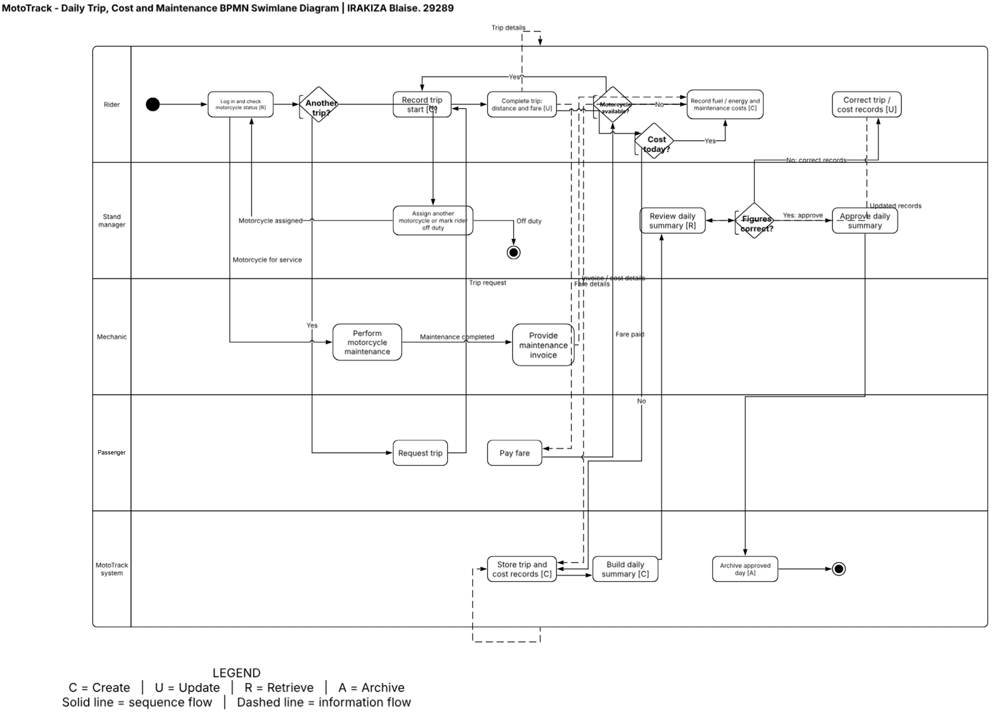

# Phase I - MotoTrack Daily Trip, Cost and Maintenance BPMN Swimlane

**Database scope note:** This process describes the real-world operating context. The database implementation uses daily summary data only; individual trip records are not loaded or stored by the project.

**Student:** Irakiza Blaise  
**Student ID:** 29289  
**Course:** INSY 8311 - Database Development with PL/SQL  
**Diagram:** `BLAISE_BPMN_Swimlane.svg` / `.png` / `.pdf`

## 1. Process overview

**Purpose:** Model the daily MotoTrack trip, cost and maintenance process from a passenger trip request through rider trip recording, fuel/energy and maintenance cost capture, daily summary approval and archiving.

**Start event:** The rider logs in / a trip is requested.

**End event:** The approved day is archived, or the rider is marked off duty.

**Outcome:** Trip and cost records are stored, daily performance is reviewed and approved, maintenance is recorded, and the approved day is archived for reporting.

**Importance:** The process links the passenger, rider, stand manager, mechanic and MotoTrack system so that trip, cost and maintenance information is captured consistently and daily performance can be approved before it is used for reporting.

## 2. Actors and responsibilities

| Lane | Actor | Responsibility |
|---|---|---|
| 1 | Rider | Logs in, checks motorcycle status, records trip start, completes the trip with distance and fare, records fuel/energy and maintenance costs, and corrects trip/cost records. |
| 2 | Stand manager | Assigns another motorcycle or marks the rider off duty, sends a motorcycle for service, reviews the daily summary, checks the figures and approves the summary. |
| 3 | Mechanic | Performs motorcycle maintenance and provides the maintenance invoice. |
| 4 | Passenger | Requests the trip and pays the fare. |
| 5 | MotoTrack system | Stores daily summary and cost records and archives the approved day. |

## 3. BPMN swimlane diagram

Files: [SVG](BLAISE_BPMN_Swimlane.svg) - [PNG](BLAISE_BPMN_Swimlane.png) - [PDF](BLAISE_BPMN_Swimlane.pdf)

## 4. Main flow

1. The passenger requests a trip.
2. The rider logs in and checks the motorcycle status.
3. **Motorcycle available?** If **Yes**, the rider records the trip start. If **No**, the stand manager assigns another motorcycle or marks the rider off duty.
4. The rider completes the trip and records distance and fare; the passenger pays the fare, and the fare details are passed to the rider.
5. **Another trip?** If **Yes**, the rider records the next trip start. If **No**, the process moves to the cost decision.
6. **Cost today?** If **Yes**, the rider records fuel or energy costs and any maintenance costs. If **No**, the cost-recording task is skipped.
7. **Motorcycle for service?** If **Yes**, the mechanic performs the maintenance and provides the invoice. If **No**, the process moves directly to the daily review.
8. The MotoTrack system stores the daily summary and cost values; individual trip details remain outside the database scope.
9. The stand manager reviews the daily summary and checks **Figures correct?**
10. If **Yes**, the stand manager approves the daily summary and the system archives the approved day.
11. If **No**, the rider corrects the trip/cost records and the summary is reviewed again.

The information flows `Trip request`, `Fare details`, `Trip details` and `Invoice / cost details` are drawn as dashed arrows inside the lanes. They show the data exchanged between the passenger, rider, mechanic and MotoTrack system without leaving the swimlane area.

## 5. Gateways and alternative paths

- **Motorcycle available?** Yes: record trip start. No: the stand manager assigns another motorcycle or marks the rider off duty.
- **Another trip?** Yes: record the next trip start. No: go to the cost decision.
- **Cost today?** Yes: record fuel/energy and maintenance costs. No: skip the cost task and go to review.
- **Motorcycle for service?** Yes: perform maintenance and provide the invoice. No: go to review.
- **Figures correct?** Yes: approve the daily summary and archive the day. No: correct the trip/cost records and review again.
- **Off duty** is an alternative end when no motorcycle is available.

Every outgoing decision arrow is labelled **Yes** or **No**.

## 6. CRUD operations

| Code | Operation | Activities in the diagram |
|---|---|---|
| `[C]` | Create | Record trip start; record fuel/energy and maintenance costs; provide the maintenance invoice; store trip and cost records; build daily summary. |
| `[R]` | Retrieve | Log in and check motorcycle status; review daily summary. |
| `[U]` | Update | Complete trip with distance and fare; assign another motorcycle or mark rider off duty; approve daily summary; correct trip/cost records. |
| `[A]` | Archive | Archive the approved day. |

## 7. Data touched

| Data object | Use |
|---|---|
| `RIDERS` | Identify the anonymised rider. |
| `DAILY_OPERATIONS` | Store one daily summary per rider, source group and date. |
| `STG_DAILY_BASELINE_FUEL` | Stage baseline fuel daily rows. |
| `STG_DAILY_TRANSITION_FUEL` | Stage transition-control fuel daily rows. |
| `STG_DAILY_TRANSITION_ELECTRIC` | Stage transition electric daily rows. |
| `MAINTENANCE_EVENTS` | Optional manually entered maintenance events; not loaded from the daily source files. |
| `AUDIT_LOG` | Record insert, update and delete activity. |
| `V_DAILY_PERFORMANCE`, `V_RIDER_SUMMARY`, `V_DAILY_TOTALS` | Report daily performance by source group. |

## 8. Business rules

1. Daily operations reference an existing rider and one of the three source groups.
2. Distance, duration, idle time and financial measures cannot be negative when present.
3. Fuel costs apply only to fuel groups; battery-swap and charging measures apply only to the electric group.
4. Missing source values remain `NULL`, never zero.
5. Profit is calculated only when revenue, maintenance and the applicable energy cost are all present.
6. Cost per kilometre is calculated only when cost data is complete and distance is greater than zero.
7. Every insert, update and delete on `DAILY_OPERATIONS` is written to `AUDIT_LOG`.

## 9. One-page explanation

MotoTrack supports daily cost and profitability analysis for motorcycle taxi operations. The BPMN process gives the real-world context: riders carry out trips and capture daily earnings and costs, while managers review and approve the daily summary. The database project imports daily summaries for baseline fuel, transition-control fuel and transition electric groups; it does not persist the individual trip events shown in the process. Missing financial values remain NULL, and incomplete days are not assigned a calculated profit.

The swimlanes make responsibility explicit: the passenger requests and pays, the rider supplies trip and cost facts, the stand manager controls assignment, service and approval, the mechanic handles maintenance, and the MotoTrack system stores, summarizes and archives the records. The `[C]`, `[R]`, `[U]` and `[A]` tags show the CREATE, READ, UPDATE and ARCHIVE operations performed by each activity. Decision gateways use labelled Yes/No arrows, and dashed information flows show the trip request, fare details, trip details and invoice/cost details exchanged across lanes. The data notes list the Oracle tables and reporting views touched by the process. The process is important because it turns operational trip, cost and maintenance records into an approved daily summary that supports profitability decisions and the Power BI dashboard.

