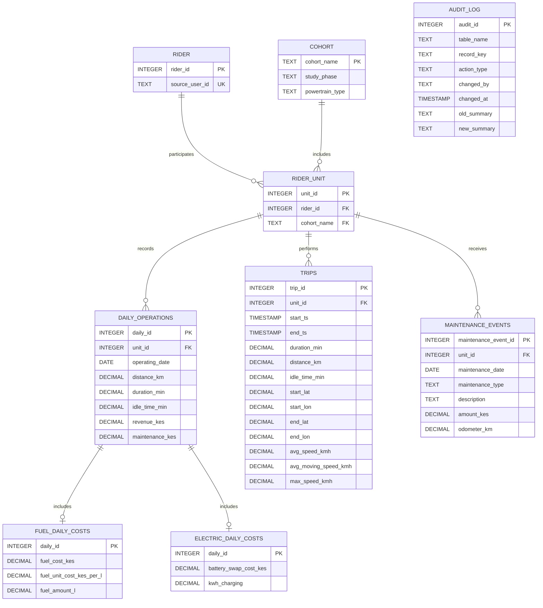

# MotoTrack — Proposed ERD (Phase II logical design)

> **Final rendered ERD:** `docs/design/erd.png` (vector source: `docs/design/erd.svg`).  
> **Full analysis:** `docs/design/normalization.md` and `docs/design/data_dictionary.md`.

This is the 3NF logical model. The diagram uses crow's-foot notation: `||--o{` is one-to-zero-or-many, `||--o|` is one-to-zero-or-one. Oracle data types and sizes are intentionally left to Phase IV.

## Key constraints

| Table | Primary key | Unique key | Foreign keys |
|---|---|---|---|
| `RIDER` | `rider_id` | `source_user_id` | — |
| `COHORT` | `cohort_name` | — | — |
| `RIDER_UNIT` | `unit_id` | (`rider_id`, `cohort_name`) | `rider_id` → `RIDER`; `cohort_name` → `COHORT` |
| `DAILY_OPERATIONS` | `daily_id` | (`unit_id`, `operating_date`) | `unit_id` → `RIDER_UNIT` |
| `FUEL_DAILY_COSTS` | `daily_id` | `daily_id` | `daily_id` → `DAILY_OPERATIONS` |
| `ELECTRIC_DAILY_COSTS` | `daily_id` | `daily_id` | `daily_id` → `DAILY_OPERATIONS` |
| `TRIPS` | `trip_id` | (`unit_id`, `start_ts`, `end_ts`, `distance_km`) | `unit_id` → `RIDER_UNIT` |
| `MAINTENANCE_EVENTS` | `maintenance_event_id` | — | `unit_id` → `RIDER_UNIT` |
| `AUDIT_LOG` | `audit_id` | — | None (standalone) |

## Notes

- `RIDER_UNIT` is the junction that resolves the many-to-many between riders and cohorts. It is also the tracked unit: 235 rows from 119 riders.
- The daily row is an aggregate of trips, but the source has no trip identifier in the daily file. `TRIPS` therefore links to `RIDER_UNIT`, not to `DAILY_OPERATIONS`.
- Fuel and electric costs are separate one-to-one children because the applicable cost group depends on the unit's powertrain. This avoids wide, mostly empty columns and removes a transitive dependency.
- `source_group` is not stored in the 3NF child tables because it is derivable from `COHORT`.
- `AUDIT_LOG` is a standalone trigger-written table; it has no foreign key and is intentionally not connected.
- `MAINTENANCE_EVENTS` has 0 rows from this dataset. The source supplies only the daily `maintenance_kes` aggregate; event-level maintenance is for future/manual entry and must not be double counted.
