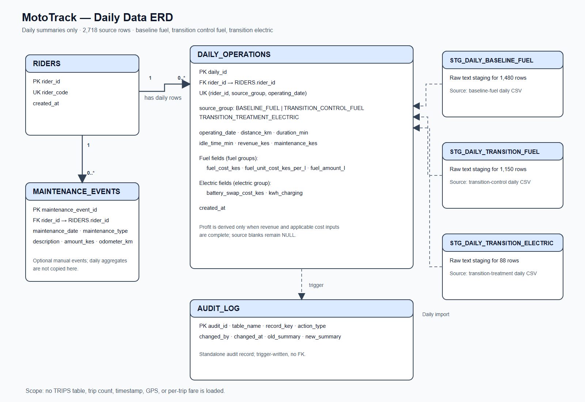

# MotoTrack – Moto Taxi Trip, Fuel and Maintenance Cost Tracker

**Student:** Irakiza Blaise  
**Student ID:** 29289  
**Course:** INSY 8311 – Database Development with PL/SQL  
**Instructor:** Eric Maniraguha  
**Institution:** Adventist University of Central Africa (AUCA)  
**Academic year:** 2026–2027  
**Repository:** https://github.com/irakizablaise75-cloud/blaise_29289_mototrack

## Problem Statement

Motorcycle taxi operators need to monitor daily trips, revenue, fuel or energy expenses, and maintenance costs. When this information is incomplete or kept in separate records, it is difficult to determine daily profitability, compare operating costs, and identify unusual expenses. MotoTrack addresses this information-management problem with a structured Oracle database and PL/SQL solution.

## Objectives

**Main objective:** Design and implement an Oracle database with PL/SQL that helps motorcycle taxi operators record, calculate and analyse trip, fuel, energy and maintenance costs.

**Specific objectives:**

1. Normalize the source data into a relational model that separates tracked units, trips, daily operations, fuel costs, electric costs and maintenance events.
2. Implement PL/SQL procedures, functions, packages, cursors and triggers that enforce business rules and calculate profit and operating cost per kilometre.
3. Provide reliable views and reports that summarize daily performance and support cost comparison between fuel and electric motorcycles.

## Proposed Solution

MotoTrack is an Oracle database application implemented with SQL and PL/SQL in Oracle SQL Developer. It stores anonymized tracked-unit information, trip records, daily operating summaries, fuel expenses, electric battery and charging measures, and audit records. Stored procedures and functions support data entry and calculations, while SQL views and reports summarize trip activity, operating costs and daily performance.

## Data Source

The dataset is the *Nairobi Motorcycle Transit Comparison Dataset: Fuel vs. Electric Vehicle Performance Tracking (2023)*, hosted on Mendeley Data (DOI: `10.17632/nv3rkn24zv.1`, licence CC BY 4.0):

https://data.mendeley.com/datasets/nv3rkn24zv

The archive contains 126,067 trip rows and 2,718 daily-summary rows across six CSV files. It covers fuel and electric motorcycle cohorts, trip distance and duration, daily revenue, maintenance costs and energy-related measures. Financial values are in Kenyan Shillings (KES), times are UTC+3, and the study area is Nairobi, Kenya.

Missing values are retained as `NULL` rather than treated as zero. The dataset does not provide separate rider names or motorcycle registration details, so the model uses **tracked units** instead of inventing personal or vehicle details. The dataset is not Rwanda-specific.

The dataset licence and citation were verified on the Mendeley record. Attribution details are recorded in `01_documentation/phase_0_research_and_proposal/research/research_log.md`.

## Innovation

The innovation is a live **Power BI analytics dashboard** connected to the MotoTrack Oracle database. Power BI reads the reporting views `VW_MOTOTRACK_DAILY_SUMMARY` and `VW_MOTOTRACK_TRIP_SUMMARY`, while all business rules and calculations remain in PL/SQL. The dashboard will show daily profit, operating cost per kilometre, fuel efficiency, revenue and maintenance trends by tracked unit, powertrain, cohort and date. Missing source values are displayed as blank, never as zero. The dashboard will be built and demonstrated in Phase VII.

## Logical Database Tables (Phase II, 3NF)

| Table | Purpose |
|---|---|
| `RIDER` | One anonymized rider, identified by `source_user_id`. |
| `COHORT` | One study cohort with its phase and powertrain type. |
| `RIDER_UNIT` | Junction between rider and cohort; the tracked unit. Unique on (`rider_id`, `cohort_name`). |
| `DAILY_OPERATIONS` | One unit-day summary: distance, duration, idle time, revenue and maintenance total. |
| `FUEL_DAILY_COSTS` | One-to-one fuel cost, unit price and litres for a fuel unit-day. |
| `ELECTRIC_DAILY_COSTS` | One-to-one battery-swap cost and charging kWh for an electric unit-day. |
| `TRIPS` | Trip-level records with timing, distance, duration, idle time, GPS and speed metrics. |
| `MAINTENANCE_EVENTS` | Separately recorded maintenance events (no source rows; future/manual). |
| `AUDIT_LOG` | Append-only insert, update and delete audit trail. |

The logical design is in `docs/design/erd.png`, `docs/design/normalization.md` and `docs/design/data_dictionary.md`. It resolves the many-to-many rider/cohort relationship with `RIDER_UNIT` and splits fuel and electric costs into separate one-to-one tables. Raw staging tables mirror the six CSV files so that blank values are preserved during import. The current Phase IV physical script keeps cohort descriptors in `RIDER_UNITS` and stores `source_group` in child tables; Phase IV will align that script to this design or document the shortcut as a controlled denormalization.

## Planned PL/SQL Features

- Records and collections.
- Implicit and explicit cursors.
- `BULK COLLECT` and `FORALL`.
- Stored procedures and functions.
- Packages with specification and body.
- Exception handling.
- Triggers that enforce data-quality rules and write to `AUDIT_LOG`.
- SQL views and PL/SQL reports.

## Repository Structure

```
.
├── README.md
├── 01_documentation/
│   ├── phase_0_research_and_proposal/
│   │   ├── Phase0_Research_and_Proposal.pdf
│   │   ├── research/research_log.md
│   │   ├── proposal/proposal.md
│   │   └── presentation/
│   │       ├── presentation_outline.md
│   │       └── MotoTrack_Phase0_Presentation.pptx
│   └── phase_I_business_process_STUDENT_ONLY/
│       ├── BLAISE_BPMN_Swimlane.svg
│       ├── BLAISE_BPMN_Swimlane.png
│       ├── BLAISE_BPMN_Swimlane.pdf
│       ├── PHASE_I_BLAISE_BPMN_EXPLANATION.md
│       ├── PHASE_I_BLAISE_BPMN_EXPLANATION.pdf
│       └── README_PHASE_I.txt
├── 03_sql/
│   ├── 01_schema/
│   ├── 02_staging/
│   ├── 03_data_loading/
│   ├── 04_packages/
│   ├── 05_triggers/
│   ├── 06_reports/
│   └── 07_tests/
├── 04_evidence/
│   └── screenshots/
├── 06_submission/
│   └── SUBMISSION_CHECKLIST.md
├── data/
│   ├── raw/                 # Six untouched CSVs, READMEs and ZIP
│   ├── original/            # Downloaded copy used for integrity checks
│   ├── processed/           # Reserved for Phase IV cleaned output
│   └── dataset_card.md      # Source, licence, size, quality and limitations
└── docs/
    └── design/
        ├── erd.png          # Logical 3NF ERD (crow's-foot)
        ├── erd.svg          # Editable vector source
        ├── normalization.md # UNF -> 1NF -> 2NF -> 3NF with real rows
        ├── data_dictionary.md
        └── phase_ii_checklist.md
```

Phase III database scripts (`02_database/`) and Phase VII innovation files (`05_innovation/`) will be added when those phases begin.

## Phase Status

- [x] Phase 0 – Research, data source and project proposal
- [ ] Phase I – Business process modeling (in progress; not pushed yet)
- [x] Phase II – Data sourcing and normalization
- [ ] Phase III – Database (PDB) creation
- [ ] Phase IV – Tables and data loading
- [ ] Phase V – PL/SQL development
- [ ] Phase VI – Advanced programming and auditing
- [ ] Phase VII – Documentation, innovation and final presentation

## Phase II – Data Sourcing and Logical Design

**Raw data:** `data/raw/` contains the six CSV files, two README files and the original ZIP. A SHA-256 check confirms that every raw file is byte-for-byte identical to the download in `data/original/`; no raw file was edited.

**Deliverables:**

- `data/dataset_card.md` — source, DOI, CC BY 4.0 licence, file sizes, record meaning, anonymization, missing values, duplicates, outliers, coverage gaps and limitations.
- `docs/design/normalization.md` — UNF → 1NF → 2NF → 3NF with real rows, named dependencies and a single-record trace for the in-class demonstration.
- `docs/design/erd.png` (and `erd.svg`) — logical ERD in crow's-foot notation.
- `docs/design/data_dictionary.md` — every table, column, key, nullability, raw-field mapping and business rule.
- `docs/design/phase_ii_checklist.md` — requirement-to-artefact map and final numeric verification.



**Logical model:** `RIDER`, `COHORT`, `RIDER_UNIT`, `DAILY_OPERATIONS`, `FUEL_DAILY_COSTS`, `ELECTRIC_DAILY_COSTS`, `TRIPS`, `MAINTENANCE_EVENTS` and `AUDIT_LOG`. `RIDER_UNIT` resolves the many-to-many between riders and cohorts. Fuel and electric costs are split into one-to-one children of `DAILY_OPERATIONS`.

**Quality headlines:**

- 128,785 data rows: 126,067 trips and 2,718 daily summaries; 119 distinct riders and 235 rider-cohort units.
- 107 of 119 riders appear in more than one cohort, and all 9 electric riders also appear in the fuel cohorts; `user_id` alone is not a unit key.
- 88 same-rider/same-date control/electric daily pairs, of which 3 match on every shared column; 3,655 duplicated trip keys across the control and electric files. They are valid separate units, not duplicates within a cohort; there are 0 exact duplicate rows inside any one file.
- Cost fields are optional: 475 fuel daily rows have all fuel fields blank, 4 electric rows have all electric fields blank, and 48/88 battery-swap and 60/88 kWh values are missing.
- 2,954 baseline, 2,288 control and 174 electric trips have at least one missing coordinate, by design.
- 307 trips have `max_speed_kmh` below `avg_speed_kmh`, 19 have an average speed above 100 km/h, 97 have zero distance, and 1 trip's duration disagrees with its timestamps.
- 172 baseline, 146 control and 20 electric unit-days are absent from the daily coverage; these are gaps, not zero-activity rows.
- No free-text categorical fields exist, so there are no spelling variants; cohort, phase and powertrain come from the six file names.

## Dataset Facts

- 126,067 trip rows across three trip CSV files.
- 2,718 daily summary rows across three daily CSV files.
- 119 distinct `user_id` values across the six CSV files.
- Daily data covers baseline fuel, transition control fuel and transition treatment electric groups.
- Trip data contains trip timing, distance, duration, idle time, GPS coordinates and speed metrics.
- Daily data contains revenue and maintenance costs, plus fuel costs for fuel motorcycles or battery-swap and charging measures for electric motorcycles.
- Blank CSV cells represent missing values and are not automatically treated as zero.

## References

1. Ampersand Energy. (2025). *Ampersand opens battery network in push for global EV makers*. https://www.ampersand.energy/
2. FIA Foundation. (2024). *A fare price: An investigation into the health costs of motorcycle taxi crashes in Kenya*. https://www.fiafoundation.org/resources/a-fare-price
3. Kenya National Bureau of Statistics. (2022). *Economic Survey 2022*. Government of Kenya. https://www.knbs.or.ke/
4. Mbutura, A., Kitetu, M., Stratford, H., & Booysen, M. J. (2025). Nairobi motorcycle transit comparison dataset: Fuel vs. electric vehicle performance tracking (2023). *Data in Brief, 61*, 111805. https://doi.org/10.1016/j.dib.2025.111805
5. Mbutura, A., Manono, S., & Kitetu, M. (2026). From fuel to electric: Mobility patterns and perceptions of commercial motorcycle operators in Nairobi, Kenya, evidence from a before-and-after field study (2023). *African Transport Studies, 4*, 100092. https://doi.org/10.1016/j.aftran.2026.100092
6. Oracle. (2023). *Oracle Database 21c documentation*. Oracle Corporation. https://docs.oracle.com/en/database/oracle/oracle-database/21/
7. Stratford, H., & Booysen, M. J. (2025). The environmental and grid impact of boda boda electrification in Nairobi, Kenya. *World Electric Vehicle Journal, 16*(8), 427. https://doi.org/10.3390/wevj16080427

The complete research log, including the key finding and gap for each source, is maintained in `01_documentation/phase_0_research_and_proposal/research/research_log.md`.
